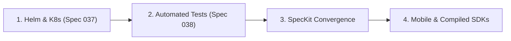

# FlagManagment — Project Status & SpecKit Health Report

> **Last Updated**: 2026-10-31  
> **Repository Branch**: `main`  
> **Status**: Late-Stage MVP / Pre-v1.0 Production Readiness  
> **Maintainer / Workflow**: Spec-Driven Development (SpecKit)

---

## 1. Executive Summary

| Domain | Status | Tests / Health | Notes |
|---|---|---|---|
| **Backend Core** | 🟢 Healthy | Unit/API: **Passing** (`go test ./...`) | Go 1.25, Chi, PostgreSQL, Redis Pub/Sub, gRPC, PII Encryption, SSO (OIDC) |
| **Frontend UI** | 🟢 Functional | Vitest: **Passing** (4 suites, 6 tests) | React 19, Vite, Tailwind, Monaco Editor, Integrations Hub (PostHog/Datadog/Slack) |
| **Core SDKs** | 🟢 Operational | Node, Go, Python, React | OpenFeature compliance, local evaluation, telemetry & analytics hooks |
| **Secondary SDKs** | 🟡 Skeletons | Java, .NET, iOS, Android | Stubs and initial interfaces scaffolded; need full evaluation logic |
| **CI / CD** | 🟢 Active | GitHub Actions | Linting, Go tests, Docker multi-stage builds, Trivy scans, Playwright E2E |
| **K8s & Helm Deployment** | 🔴 Missing | `deploy/` unbuilt | Spec 037 defined but manifests/Helm charts not yet created |
| **SpecKit Governance** | 🟡 Partial | 39 total specs | 19 completed, 11 untracked in tasks.md, 6 missing tasks, 3 pending planning |

---

## 2. Component Health & Architecture State

### 2.1 Backend (`backend/`)
- **Runtime**: Go 1.25.0
- **Routing & Framework**: Chi router, PostgreSQL database migrations (`000001` through `000029`), Redis Pub/Sub caching.
- **Capabilities Delivered**:
  - Boolean and multivariate flag evaluations with percentage rollouts.
  - Granular contextual targeting rules and sequential flag dependencies.
  - Environment management and ephemeral environment cloning.
  - Multi-user RBAC, OIDC/SSO single sign-on, and audit logging with SIEM formatting.
  - Change request approval workflows and scheduled flag changes.
  - Edge proxy service (`proxy/`) and Terraform provider (`providers/terraform/`).

### 2.2 Frontend (`frontend/`)
- **Runtime**: React 19, TypeScript, Vite, Tailwind CSS.
- **Key Modules**:
  - Project and Environment context switching with SDK key display.
  - Flag creation and targeting rule builder.
  - Remote Config JSON builder with Monaco syntax highlighting and validation.
  - Change request diff viewer (`react-diff-viewer-continued`) and review flows.
  - Integrations Hub for PostHog, Datadog, and Slack webhooks.
- **Testing**: Vitest (`Login`, `IntegrationsPage`, `ProjectsList`, `RemoteConfigBuilder`).

### 2.3 SDK Matrix (`sdk/`)
- **Node.js (`sdk/node/`)**: Full client, evaluator, OpenFeature provider, PostHog hook.
- **Go (`sdk/go/`)**: Full client, in-memory evaluator, PostHog & Datadog metrics hooks.
- **Python (`sdk/python/`)**: Evaluator, OpenFeature provider, PostHog analytics integration.
- **React (`sdk/react/`)**: `FlagProvider`, `useFlag` hooks, evaluated state streaming.
- **Java / .NET / iOS / Android**: Basic directory stubs awaiting client implementation.

### 2.4 End-to-End & Infrastructure (`e2e/`, `.github/workflows/`)
- Playwright E2E suite in [`e2e/tests/core.spec.ts`](../e2e/tests/core.spec.ts) covering authentication, dashboard loading, and flag creation.
- Workflows in [`.github/workflows/`](../.github/workflows/):
  - `ci.yml`: Runs linter, backend tests, Docker builds, and E2E tests.
  - `publish.yml` & `release.yml`: Release automation and container registry packaging.

---

## 3. SpecKit Specification Matrix (001 – 039)

| Spec ID & Name | spec.md | plan.md | tasks.md | Tasks Status | Actual Implementation State |
|---|---|---|---|---|---|
| `001-core-architecture` | ✅ | ✅ | ✅ | 42/42 (100%) | Complete |
| `002-data-model-state` | ✅ | ✅ | ✅ | 34/40 (85%) | Implemented in migrations |
| `003-core-api` | ✅ | ✅ | ✅ | 3/14 (21%) | Implemented in Chi handlers |
| `004-frontend-dashboard` | ✅ | ✅ | ✅ | 31/31 (100%) | Complete |
| `005-sdk-evaluation-api` | ✅ | ✅ | ✅ | 23/23 (100%) | Complete |
| `006-nodejs-sdk` | ✅ | ✅ | ✅ | 26/26 (100%) | Complete |
| `007-rbac-user-management` | ✅ | ✅ | ✅ | 28/28 (100%) | Complete |
| `008-change-requests-workflow` | ✅ | ✅ | ✅ | 30/30 (100%) | Complete |
| `009-telemetry-kill-switches` | ✅ | ✅ | ✅ | 20/20 (100%) | Complete |
| `010-slack-notifications` | ✅ | ✅ | ✅ | 10/10 (100%) | Complete |
| `011-flag-promotions` | ✅ | ✅ | ✅ | 7/7 (100%) | Complete |
| `012-contextual-targeting` | ✅ | ✅ | ✅ | 0/8 (0%) | Implemented (tasks untracked) |
| `013-multivariate-flags` | ✅ | ✅ | ✅ | 15/15 (100%) | Complete |
| `014-scheduled-flags` | ✅ | ✅ | ✅ | 24/24 (100%) | Complete |
| `015-stale-flag-management` | ✅ | ✅ | ✅ | 24/24 (100%) | Complete |
| `016-sequential-dependencies` | ✅ | ✅ | ✅ | 0/14 (0%) | Implemented (tasks untracked) |
| `017-sdk-event-forwarding` | ✅ | ✅ | ✅ | 0/8 (0%) | Implemented in Go/Node/Python SDKs |
| `018-environment-cloning` | ✅ | ✅ | ✅ | 1/11 (9%) | Implemented in backend |
| `019-edge-proxy-relay` | ✅ | ✅ | ✅ | 0/30 (0%) | Scaffolded in `proxy/` |
| `020-audit-logs-siem` | ✅ | ✅ | ✅ | 20/20 (100%) | Complete |
| `021-pii-hashing-privacy` | ✅ | ✅ | ✅ | 12/12 (100%) | Complete |
| `022-enterprise-sso` | ✅ | ✅ | ✅ | 0/14 (0%) | Implemented in `auth.go` (OIDC) |
| `023-additional-language-sdks` | ✅ | ✅ | ✅ | 36/36 (100%) | Stubs & basic SDKs created |
| `024-openfeature-compliance` | ✅ | ✅ | ✅ | 7/7 (100%) | Complete |
| `025-terraform-provider` | ✅ | ✅ | ✅ | 25/25 (100%) | Resources & Data Sources complete |
| `026-remote-config-ui` | ✅ | ✅ | ✅ | 0/13 (0%) | Implemented in frontend |
| `027-login-error-feedback` | ✅ | ✅ | ❌ | - | Implemented in UI |
| `028-empty-state-onboarding` | ✅ | ✅ | ❌ | - | Implemented in UI |
| `029-flag-toggle-feedback` | ✅ | ✅ | ❌ | - | Implemented in UI |
| `030-env-context-switching` | ✅ | ✅ | ❌ | - | Implemented in UI |
| `031-flagcompatitor-ux-parity` | ✅ | ✅ | ✅ | 16/16 (100%) | Complete |
| `032-environment-sdk-key-ux` | ✅ | ✅ | ✅ | 3/8 (38%) | Implemented in UI/API |
| `033-server-side-keys-management` | ✅ | ✅ | ✅ | 4/19 (21%) | Implemented in UI/API |
| `034-user-management-api` | ✅ | ✅ | ✅ | 0/22 (0%) | Implemented in API |
| `035-flag-creation-targeting-workflows` | ✅ | ✅ | ❌ | - | Implemented in UI |
| `036-cicd-security-release-workflows` | ✅ | ✅ | ✅ | 6/6 (100%) | Complete |
| `037-k8s-helm-production-deployment` | ✅ | ❌ | ❌ | - | **Unbuilt (Needs Plan & Tasks)** |
| `038-comprehensive-test-plan` | ✅ | ❌ | ❌ | - | **158 test cases documented; execution unautomated** |
| `039-gap-analysis-and-enhancements` | ✅ | ❌ | ❌ | - | **Gap analysis documented** |

---

## 4. Key Gaps & Missing Requirements

1. **Kubernetes Helm Deployment ([Spec 037](../specs/037-k8s-helm-production-deployment/spec.md))**:
   - No `deploy/helm/flagmanagment` chart exists.
   - Missing automated database migration K8s Job, Redis HA / Sentinel templates, and ingress TLS configurations.
2. **Automated Validation Matrix for 158 Test Cases ([Spec 038](../specs/038-comprehensive-test-plan/spec.md))**:
   - Spec 038 has comprehensive Given/When/Then cases, but test execution lacks automated test tracking.
3. **Frontend Test Scripting**:
   - `frontend/package.json` lacks `"test": "vitest run"`.
   - Coverage is low (only 4 test files for the entire dashboard).
4. **Mobile & Enterprise SDK Logic**:
   - Java, .NET, iOS, and Android directories contain minimal stubs compared to the fully evaluated Node, Go, Python, and React SDKs.
5. **SpecKit Task Convergence**:
   - 11 specs have completed code in the repository but have untracked `tasks.md` checkboxes.

---

## 5. Enhancement Roadmap

### Phase 1: Kubernetes Helm Deployment (Spec 037)
- Run `/speckit-plan` and `/speckit-tasks` on `specs/037-k8s-helm-production-deployment`.
- Implement `deploy/helm/flagmanagment` with backend, frontend, postgres, redis, and ingress templates.

### Phase 2: Test Plan Automation (Spec 038)
- Add `"test": "vitest run"` and `"test:coverage"` to `frontend/package.json`.
- Implement automated integration and Playwright E2E tests addressing test cases in `038-comprehensive-test-plan`.

### Phase 3: SpecKit Workflow Convergence
- Reconcile `tasks.md` across specs `002` through `035` so SpecKit reporting matches actual code.

### Phase 4: Extended SDK Suite
- Implement local evaluation logic for `sdk/java`, `sdk/dotnet`, `sdk/ios`, and `sdk/android`.

---

## 6. Update Log

- **2026-10-31**: Initial creation of project status tracking file. Synced git main, verified backend and frontend tests, compiled 39-spec matrix, and identified key production gaps.

