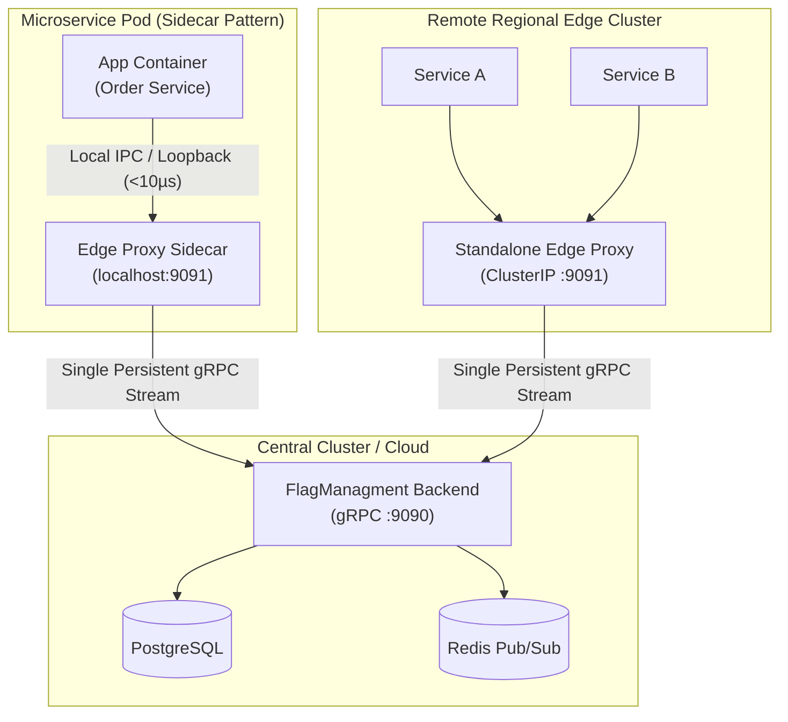

# FlagManagment Kubernetes Sidecar & Edge Proxy Patterns

This directory provides production Kubernetes patterns for embedding the **FlagManagment Edge Proxy** to achieve sub-millisecond in-memory flag evaluation with zero network hops across pod boundaries.

---

## Deployment Architectures



---

## Pattern 1: In-Pod Sidecar (Zero-Hop Evaluation)

In high-throughput microservices (e.g. payment processing, order routing, authentication), network latency to a centralized flag server can introduce unacceptable overhead.

By placing `flagmanagment-proxy` as a **sidecar container** inside the application pod:
- Flag evaluations happen over `localhost:9091` loopback with **< 10 µs latency**.
- Upstream network failure does not impact flag evaluation: the proxy serves evaluations from its last known good in-memory cache snapshot.
- Only the proxy connects to the central FlagManagment server, completely eliminating database connection pool exhaustion.

### Example Manifest

See [`sidecar-pattern.yaml`](./sidecar-pattern.yaml).

```yaml
spec:
  containers:
    - name: my-service
      image: mycompany/service:v1
      env:
        - name: FLAGMANAGMENT_GRPC_ENDPOINT
          value: "localhost:9091"
    - name: flagmanagment-edge-proxy
      image: ghcr.io/malah-code/flagmanagment-proxy:v1.0.0
      env:
        - name: FM_PROXY_BACKEND_ADDR
          value: "flagmanagment-backend.flagmanagment.svc.cluster.local:9090"
```

---

## Pattern 2: Regional Cluster Standalone Proxy (via Helm)

For environments hosting hundreds of microservices where running a sidecar per pod is unnecessary, deploy Edge Proxy as an internal `ClusterIP` service:

```bash
helm upgrade --install flagmanagment deploy/helm/flagmanagment \
  --set edgeProxy.enabled=true \
  --set edgeProxy.replicaCount=3 \
  --set edgeProxy.autoscaling.enabled=true
```

Downstream services simply point to `flagmanagment-edge-proxy:9091`.
