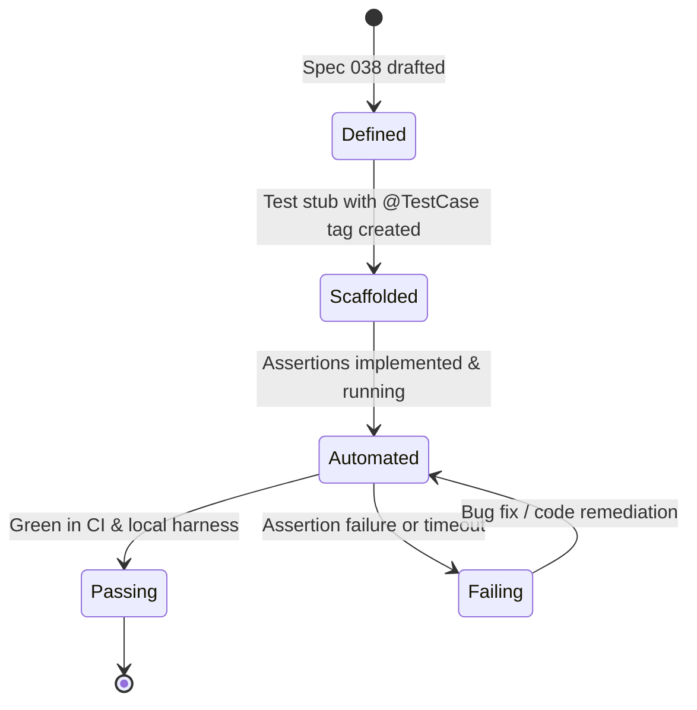

# Data Model: Automated Test Execution Framework

**Branch**: `038-comprehensive-test-plan` | **Date**: 2026-10-31

This document defines the entity schemas and data models for test cases, test execution runs, and benchmark verification within the FlagManagment test framework.

---

## 1. Entities & Schemas

### 1.1 TestCase

Represents one of the 158 canonical test cases defined in `spec.md`.

| Field | Type | Description | Validation / Constraints |
|---|---|---|---|
| `id` | String | Unique stable identifier (e.g., `TC-AUTH-001`) | Format: `^TC-[A-Z]+-[0-9]{3}$` (Mandatory, Immutable) |
| `area` | String | Functional area (e.g., `Authentication`, `RBAC`, `Targeting`) | Must match one of 24 canonical areas |
| `layer` | Enum | Testing layer where this case executes | `API`, `UI`, `SDK`, `INFRA`, `E2E` |
| `source_specs` | Array[String] | Specs referenced (e.g., `["007", "027"]`) | Non-empty list of spec numbers |
| `given` | String | Precondition description | Required |
| `when` | String | Action / stimulus description | Required |
| `then` | String | Expected outcome / assertion | Required |
| `status` | Enum | Implementation status | `AUTOMATED`, `MANUAL_VERIFIED`, `PENDING` |

### 1.2 TestExecutionRun

Represents a single invocation of the test suite (in CI or locally).

| Field | Type | Description |
|---|---|---|
| `run_id` | UUID | Unique execution run identifier |
| `timestamp` | ISO-8601 String | Execution start timestamp |
| `git_commit` | String | Git commit hash evaluated |
| `branch` | String | Git branch |
| `layer` | String | Executed layer filter (`all`, `backend`, `frontend`, `e2e`, `sdk`) |
| `total_cases` | Integer | Total test cases discovered |
| `passed_count` | Integer | Cases passing |
| `failed_count` | Integer | Cases failing |
| `skipped_count` | Integer | Cases skipped |
| `duration_ms` | Integer | Total wall-clock time in milliseconds |
| `coverage_backend_pct` | Float | Go backend test coverage percentage |
| `coverage_frontend_pct` | Float | React frontend test coverage percentage |

### 1.3 TestResultItem

Result for an individual test case within an execution run.

| Field | Type | Description |
|---|---|---|
| `test_case_id` | String | Reference to `TestCase.id` |
| `file_path` | String | Source file containing the test execution |
| `test_name` | String | Native test function name (e.g., `TestLoginSuccess`) |
| `status` | Enum | Outcome: `PASS`, `FAIL`, `SKIP` |
| `duration_ms` | Float | Execution duration in milliseconds |
| `error_message` | String (Nullable) | Failure reason or assertion diff |
| `stack_trace` | String (Nullable) | Stack trace if failed |

### 1.4 BenchmarkResult

Represents in-memory evaluation latency benchmarks for Constitution Principle IV.

| Field | Type | Description | Requirement |
|---|---|---|---|
| `sdk_language` | String | Language under test (`go`, `node`, `python`, etc.) | Required |
| `iterations` | Integer | Number of flag evaluations executed (e.g., 100,000) | Minimum 10,000 |
| `p50_duration_ns` | Integer | 50th percentile latency in nanoseconds | Advisory |
| `p95_duration_ns` | Integer | 95th percentile latency in nanoseconds | **MUST be < 1,000,000 ns (1.0 ms)** |
| `allocs_per_op` | Integer | Heap allocations per evaluation | Advisory |
| `passed` | Boolean | True if p95 < 1ms | Required |

---

## 2. State Transitions (TestCase Lifecycle)

