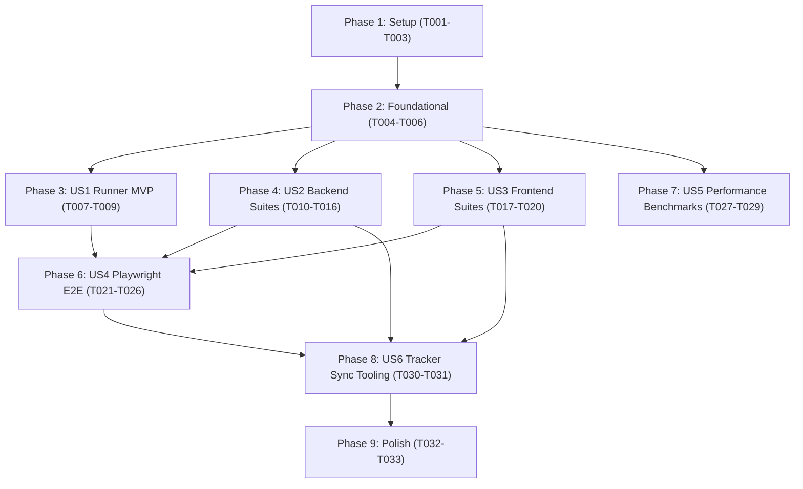

# Tasks: Comprehensive Test Plan Automation Framework

**Input**: Design documents from `/specs/038-comprehensive-test-plan/`
**Prerequisites**: [plan.md](plan.md), [spec.md](spec.md), [research.md](research.md), [data-model.md](data-model.md), [contracts/test-runner-contract.json](contracts/test-runner-contract.json)

---

## Phase 1: Setup (Shared Infrastructure)

**Purpose**: Test runners and tooling configuration

- [x] T001 Configure test scripts in frontend/package.json
- [x] T002 [P] Create mock OIDC and mock Webhook test utilities in backend/tests/testutil/mocks.go
- [x] T003 [P] Configure Playwright E2E configuration and browser projects in e2e/playwright.config.ts

---

## Phase 2: Foundational (Blocking Prerequisites)

**Purpose**: Core orchestration infrastructure required before individual test suites execute

**⚠️ CRITICAL**: No user story test suite work can begin until this phase is complete

- [x] T004 Implement unified test orchestrator harness script in scripts/run-all-tests.sh
- [x] T005 [P] Implement test result JSON and JUnit XML parser in scripts/test_reporter.py
- [x] T006 [P] Implement database setup and tear down helpers for integration tests in backend/tests/testutil/db.go

---

## Phase 3: User Story 1 - Unified Test Runner & CI Harness (Priority: P1) 🎯 MVP

**Goal**: Deliver a single runnable CLI script and CI quality gate verifying all tiers with consolidated status.

**Independent Test**: Running `./scripts/run-all-tests.sh --all` executes backend, frontend, and SDK tests and exits with code 0.

- [x] T007 [US1] Create execution test for runner CLI flags in scripts/test_runner_test.sh
- [x] T008 [P] [US1] Add multi-tier test execution logic to scripts/run-all-tests.sh
- [x] T009 [US1] Wire unified test runner and coverage threshold checks into .github/workflows/ci.yml

---

## Phase 4: User Story 2 - Backend API & Governance Test Suites (Priority: P1)

**Goal**: Automate verification of the core backend API, targeting rules, RBAC, change requests, and audit logs.

**Independent Test**: Running `go test -v ./tests/api/... ./tests/governance/...` passes with zero failures.

- [x] T010 [P] [US2] Implement Authentication and User Management tests (TC-AUTH-001 to TC-AUTH-010) in backend/tests/api/auth_test.go
- [x] T011 [P] [US2] Implement Project and Environment isolation tests (TC-PROJ-001 to TC-PROJ-005, TC-ENV-001 to TC-ENV-010) in backend/tests/api/env_test.go
- [x] T012 [P] [US2] Implement Feature Flag and Contextual Targeting tests (TC-FLAG-001 to TC-FLAG-016, TC-CTX-001 to TC-CTX-010) in backend/tests/api/flag_test.go
- [x] T013 [P] [US2] Implement Change Request approval workflow tests (TC-CR-001 to TC-CR-007) in backend/tests/governance/change_request_test.go
- [x] T014 [P] [US2] Implement RBAC permission boundary tests (TC-RBAC-001 to TC-RBAC-007) in backend/tests/governance/rbac_test.go
- [x] T015 [P] [US2] Implement Immutable Audit Log and SIEM formatting tests (TC-AUDIT-001 to TC-AUDIT-008) in backend/tests/governance/audit_test.go
- [x] T016 [P] [US2] Implement PII Hashing and data sanitization tests (TC-PII-001 to TC-PII-003) in backend/tests/api/pii_test.go

---

## Phase 5: User Story 3 - Frontend Vitest Component Suites (Priority: P2)

**Goal**: Automate unit and component tests across critical dashboard user interactions.

**Independent Test**: Running `cd frontend && npm test` passes with all tests green.

- [x] T017 [P] [US3] Implement Login error handling and feedback tests in frontend/src/__tests__/LoginError.test.tsx
- [x] T018 [P] [US3] Implement Flag targeting and rule builder tests in frontend/src/__tests__/FlagTargeting.test.tsx
- [x] T019 [P] [US3] Implement Environment context switching and SDK key display tests in frontend/src/__tests__/EnvSwitching.test.tsx
- [x] T020 [P] [US3] Implement Change Request diff viewer and approval action tests in frontend/src/__tests__/ChangeRequestDiff.test.tsx

---

## Phase 6: User Story 4 - End-to-End Critical User Journeys (Priority: P2)

**Goal**: Automate browser verification for the 6 end-to-end user scenarios defined in Part 24 of spec.md.

**Independent Test**: Running `npx playwright test` succeeds in headless Chromium against Docker Compose.

- [x] T021 [P] [US4] Implement CUJ-1 Developer Flag Rollout & Targeting Journey in e2e/tests/cuj_flag_rollout.spec.ts
- [x] T022 [P] [US4] Implement CUJ-2 Release Manager Promotion Pipeline Journey in e2e/tests/cuj_flag_promotion.spec.ts
- [x] T023 [P] [US4] Implement CUJ-3 Audit Log SIEM Compliance Journey in e2e/tests/cuj_audit_siem.spec.ts
- [x] T024 [P] [US4] Implement CUJ-4 Ephemeral Environment Cloning Journey in e2e/tests/cuj_ephemeral_env.spec.ts
- [x] T025 [P] [US4] Implement CUJ-5 Automated Kill-Switch & Stale Flag Journey in e2e/tests/cuj_kill_switch.spec.ts
- [x] T026 [P] [US4] Implement CUJ-6 OpenFeature Multi-Language Conformance Journey in e2e/tests/cuj_openfeature.spec.ts

---

## Phase 7: User Story 5 - Sub-Millisecond Benchmark Suite (Priority: P1)

**Goal**: Enforce Constitution Principle IV via automated performance benchmarks.

**Independent Test**: Running `go test -bench=BenchmarkEvaluateFlag ./internal/sdk/...` asserts p95 latency < 1.0ms.

- [x] T027 [P] [US5] Implement Go SDK in-memory evaluation latency benchmark with sub-millisecond assertion in backend/internal/sdk/evaluator_bench_test.go
- [x] T028 [P] [US5] Implement Node SDK evaluation latency benchmark with sub-millisecond assertion in sdk/node/src/__tests__/benchmark.test.ts
- [x] T029 [US5] Wire benchmark execution and p95 latency check into scripts/run-all-tests.sh

---

## Phase 8: User Story 6 - Test Matrix Synchronization Tooling (Priority: P3)

**Goal**: Synchronize live automated test outcomes with the canonical tracker documentation.

**Independent Test**: Running `python3 scripts/sync-test-tracker.py` updates docs/TEST_EXECUTION_TRACKER.md.

- [x] T030 [US6] Implement AST and regex tag parser for test cases in scripts/sync-test-tracker.py
- [x] T031 [US6] Implement Markdown table generator to update docs/TEST_EXECUTION_TRACKER.md

---

## Phase 9: Polish & Cross-Cutting Concerns

**Purpose**: Documentation, developer onboarding, and local validation

- [x] T032 Add test failure troubleshooting guide to docs/GETTING_STARTED.md
- [x] T033 Verify all test commands execute smoothly in local container environment via docker-compose.yml

---

## Dependencies & Execution Order

